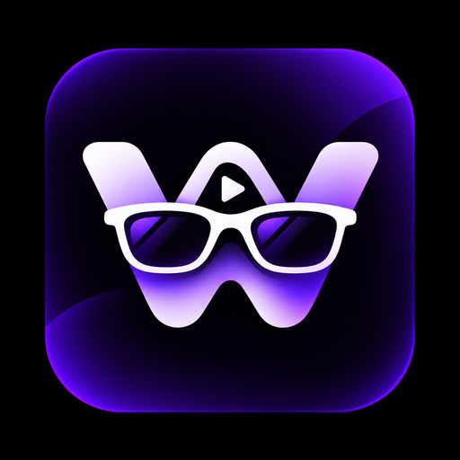

<div align="center">



# Wave Music (Wvusic)

**YouTube Music without the ads or telemetry — for Android, Windows and Linux.**

Your library, playlists, synced lyrics, offline downloads and Listen Together.

[Android](#android) · [Windows](#windows) · [Linux](#linux)

</div>

Wave Music is a free, open-source YouTube Music client built from
[Metrolist](https://github.com/MetrolistGroup/Metrolist) on Android and
[Lyrenne](https://github.com/Doctordefector/Lyrenne) on the desktop. The desktop
build uses Compose Desktop with VLC for playback; the Android build uses Media3
and Material 3.

## Download

| Platform | Version | Package | Release |
| --- | --- | --- | --- |
| Android | 1.0.0 | `Wvusic.apk` | [android-v1.0.0](https://github.com/AdtyRz/Wave-Music/releases/tag/android-v1.0.0) |
| Windows | 1.1.1 | `Wvusic-1.1.1-portable.zip` | [windows-v1.1.1](https://github.com/AdtyRz/Wave-Music/releases/tag/windows-v1.1.1) |
| Linux | 1.2.1 | `.tar.gz`, `.deb`, `.rpm` | [linux-v1.2.1](https://github.com/AdtyRz/Wave-Music/releases/tag/linux-v1.2.1) |

Every desktop release includes a `.sig` file. The app verifies that signature
before installing an update, and refuses anything that does not match.

## Minimum device specifications

### Android

| | |
| --- | --- |
| OS | Android 8.0 Oreo (API 26) or newer |
| CPU | ARMv7, ARM64, x86 or x86_64 — the universal APK contains all four |
| RAM | 2 GB minimum, 3 GB or more recommended |
| Storage | About 150 MB free for the app, plus space for downloads and cache |
| Network | Internet connection required for streaming, search and library sync |

### Windows

| | |
| --- | --- |
| OS | Windows 10 64-bit (version 1809 or newer) or Windows 11 |
| CPU | 64-bit x86; ARM64 is not supported yet |
| RAM | 4 GB minimum, 8 GB recommended |
| Storage | About 600 MB free (the unpacked folder is about 410 MB), plus downloads |
| Display | 1280×720 or larger |
| Runtime | VLC and ffmpeg are bundled; no Java install is needed |

### Linux

| | |
| --- | --- |
| OS | 64-bit Linux (x86_64) with glibc 2.17 or newer |
| Session | X11 or Wayland (the app runs through XWayland) |
| Player | VLC 3.0 or newer — `libvlc5` + `vlc-plugin-base` on Debian/Ubuntu, `vlc` on Fedora/openSUSE |
| RAM | 4 GB minimum, 8 GB recommended |
| Storage | About 500 MB free for the app, plus downloads and cache |
| Display | 1280×720 or larger |
| Audio | PipeWire, PulseAudio or ALSA |

On older integrated GPUs, if the interface lags, start with software rendering:

```bash
_JAVA_OPTIONS="-Dskiko.renderApi=SOFTWARE -Dskiko.vsync.enabled=false" wvusic
```

## Updates

Each app checks GitHub for its own platform release on launch and from
**Settings → Updates**:

- **Windows / Linux** — press **Update now**. The app downloads the release,
  verifies the signature and restarts into the new version. Package-managed
  Linux installs hand the `.deb`/`.rpm` to your package manager.
- **Android** — press **Update**. The APK download opens in your browser and
  Android asks you to confirm the install, as it does for any app installed
  outside Play.

## Sign-in

On Windows and Linux, Wave Music signs in through a browser you choose
(Edge, Chrome, Chromium, Brave, Firefox, LibreWolf or Vivaldi). It opens a
clean, throwaway profile — your normal browser profile is never read. On
Android, sign-in uses the app's built-in WebView.

## Source branches

| Branch | Contents |
| --- | --- |
| `android` | Android application (Kotlin, Jetpack Compose) |
| `windows` | Windows desktop build (Kotlin, Compose Desktop) |
| `linux` | Linux desktop build (Kotlin, Compose Desktop) |
| `wvusic` | This landing page and release documentation |

## License

GPL-3.0. See [LICENSE](LICENSE) and [NOTICE.md](NOTICE.md).
